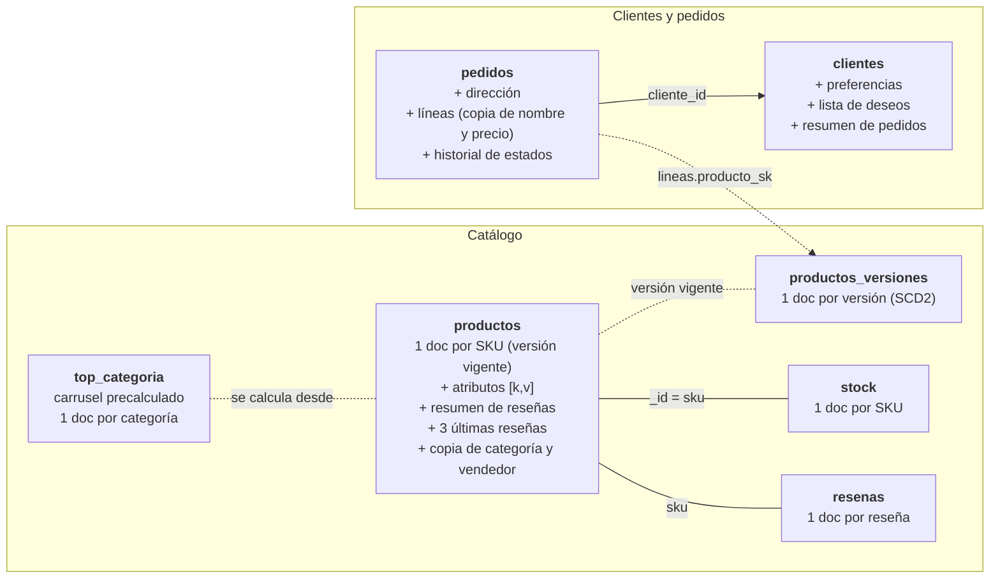

# Parte B · El modelo documental

Cada decisión de esta parte sale de una cifra de la [Parte A](A_carga.md): el máximo de hijos por padre (A.2), lo que lee cada operación (A.3) y la tolerancia de cada dato (A.4).

---

## Resultado: siete colecciones



Línea continua: referencia por clave. Línea discontinua: relación que solo se usa para mantener o auditar datos.

---

## B.1 · Las relaciones del dominio

| Relación | Tipo | Mín. | Media | **Máx.** | ¿Tiene límite? | ¿El hijo tiene sentido sin el padre? |
|---|---|---:|---:|---:|---|---|
| producto → categoría | N:1 | 1 | 1 | 1 | — | Sí (la categoría existe sola) |
| producto → vendedor | N:1 | 1 | 1 | 1 | — | Sí |
| vendedor → productos | 1:N | 1 | 150 | **32.459** | No | Sí |
| producto → atributos | 1:N | 5 | 16,6 | 17 | **Sí** (por diseño) | No |
| producto → versiones | 1:N | 1 | 1,2 | 2 | **No**: +1 con cada E2 | Sí: las líneas antiguas la necesitan |
| producto → reseñas | 1:N | 0 | 4,6 | **43.020** | No | Sí: se leen y se paginan sueltas |
| producto → stock | 1:1 | 1 | 1 | 1 | — | No |
| pedido → líneas | 1:N | 1 | 3,0 | 40 | **Sí** (en la práctica) | No |
| pedido → historial | 1:N | 1 | 4,7 | 5 | **Sí** (máquina de estados) | No |
| pedido → dirección | 1:1 | 1 | 1 | 1 | — | No |
| cliente → pedidos | 1:N | 0 | 3,5 | **4.452** | No | Sí |
| cliente → preferencias | 1:1 | 1 | 1 | 1 | — | No |
| cliente ↔ producto (deseos) | N:M | 0 | 3,2 | 14 por cliente | No natural, pero pequeño | No |
| línea → producto | N:1 | 1 | 1 | 1 | — | — |

---

## B.2 · Incrustar o referenciar

Criterios del enunciado: **I** = a favor de incrustar (simplicidad, van juntos, se consultan juntos, se actualizan juntos, se archivan juntos); **R** = a favor de referenciar (cardinalidad alta, duplicación, tamaño, crecimiento, carga de escritura distinta, individualidad).

| Relación | A favor | En contra | **Decisión** |
|---|---|---|---|
| pedido → líneas | Se leen siempre juntos (L4, L5), se crean juntos (E1), se archivan juntos | — (máx. 40) | **Incrustar** |
| pedido → historial | Se lee siempre con el pedido (L4, L5); E3 escribe en el mismo pedido | — (máx. 5) | **Incrustar** |
| pedido → dirección | 1:1, se lee con el pedido | — | **Incrustar** |
| producto → atributos | Se leen con el producto (L1, L2), se editan con él (E4) | — (máx. 17) | **Incrustar** con el patrón *attribute* (B.5) |
| producto → categoría y vendedor | L1 necesita sus nombres en cada visita | Duplicación: el vendedor 1 tiene 32.459 productos | **Referenciar y copiar** solo los campos que lee L1 (patrón *extended reference*) |
| producto → reseñas | L1 muestra 3 y un resumen | Cardinalidad, tamaño, crecimiento, individualidad | **Referenciar** + resumen y 3 últimas en el producto (patrones *computed* y *subset*) |
| producto → versiones | — | Crecimiento; la versión antigua vive sola | **Referenciar** (colección aparte) |
| producto → stock | 1:1 | **Carga de escritura distinta**: cambia con cada pedido | **Referenciar** (B.3) |
| cliente → pedidos | — | Cardinalidad (4.452), crecimiento | **Referenciar** (`cliente_id` en el pedido) + resumen en el cliente |
| cliente → preferencias | 1:1, se leen juntos | — | **Incrustar** |
| cliente → deseos | Se consultan desde el cliente; E1 los borra con el cliente | Sin límite natural | **Incrustar** (máx. 14) |

### Las tres contradicciones del enunciado

**1. Producto y reseñas.** *Si se metieran todas dentro, ¿cuánto ocuparía el producto con más reseñas?*

43.020 reseñas × ~300 bytes ≈ **13 MB**. Cabe, por poco, en el límite de 16 MB, pero:
- L1 se lanza 2,9 millones de veces al día y solo muestra **3** reseñas: cada visita cargaría 13 MB para usar 1 KB.
- El documento seguiría creciendo con cada reseña hasta romper el límite.
- Cada reseña nueva reescribiría un documento de 13 MB.

**Decisión:** las reseñas van en su propia colección, y el producto guarda **solo lo que L1 necesita**: un **resumen** (número, suma y histograma, el patrón *computed*) y las **3 últimas** (patrón *subset*). Al publicar una reseña, una sola actualización atómica del producto incrementa los contadores y mete la reseña en la lista recortándola a 3 (`$push` con `$slice`). El producto atípico pesa lo mismo que los demás. Es la misma solución que `resena_resumen` en la [R.2](R2_pg_mejorado.md#l1--ficha-de-producto).

**2. Línea de pedido y producto.** *Si mañana el vendedor ejecuta E2, ¿qué precio debe ver el cliente en el pedido de la semana pasada?*

**El que pagó.** Por eso la línea **copia** el precio unitario y el nombre del producto en el momento de la compra, y guarda además la referencia a la versión vendida (`producto_sk`). Aquí duplicar no es un problema de mantenimiento: es **justo lo que se quiere**, una foto que no debe cambiar. Así L4 y L5 leen un único documento, sin consultar productos ni versiones.

**3. Producto y versiones.** *E2 crea versiones nuevas. ¿Dónde se guardan las antiguas para que un pedido viejo sepa qué versión compró?*

En la colección **`productos_versiones`**, un documento por versión con su `_id` igual al `producto_sk` de PostgreSQL. La colección `productos` solo contiene la versión **vigente** (lo que leen L1 y L2), y cada línea de pedido guarda el `producto_sk` de la versión que compró. No se pierde el historial de precios (lo comprobaremos en la parte C.4: deben salir las mismas 198.542 líneas con versión antigua).

---

## B.3 · Relaciones uno a uno

| Relación | ¿Incrustar? | Por qué |
|---|---|---|
| pedido → dirección de envío | **Sí** | Se lee y se escribe con el pedido, y no cambia por separado |
| cliente → preferencias | **Sí** | Se leen con el cliente; cambian poco |
| **producto → stock** | **No** | **El stock cambia con cada pedido**, el resto del producto casi nunca. Si estuviera dentro, cada venta reescribiría el documento del producto (con su ficha técnica y sus reseñas) y competiría con las 2,9 M de lecturas diarias de L1. Además, las transacciones de E1 bloquearían el documento entero del producto, no solo el contador. Separarlo deja el producto casi de solo lectura y el stock como un documento pequeño y muy escrito |

---

## B.4 · Relaciones uno a muchos según el número de hijos

| Relación | Clase | Decisión |
|---|---|---|
| pedido → líneas (máx. 40) | **Pocos** | Incrustar |
| pedido → historial (máx. 5) | **Pocos** | Incrustar |
| producto → atributos (máx. 17) | **Pocos** | Incrustar |
| producto → versiones (hoy 2, crece con cada E2) | **Muchos con el tiempo** | Referenciar |
| producto → reseñas (máx. 43.020) | **Sin límite** | Referenciar + **patrón subconjunto** (3 últimas) + resumen precalculado |
| cliente → pedidos (máx. 4.452) | **Sin límite** | Referenciar + resumen precalculado en el cliente (nº de pedidos y gasto) |
| vendedor → productos (máx. 32.459) | **Sin límite** | Referenciar (`vendedor.id` en el producto) |

**¿Subconjunto o cubo?** Para las reseñas, el **subconjunto** encaja: L1 siempre quiere "las N más recientes", así que basta con mantener esas N en el padre. El **patrón cubo** (agrupar hijos en documentos de, por ejemplo, 100 reseñas) serviría para paginar todas las reseñas de un producto con pocas lecturas; ninguna de las diez operaciones lo necesita, así que no se aplica.

**El producto con 43.020 reseñas** no penaliza a los otros 479.999: su documento en `productos` tiene el mismo tamaño que el de cualquier otro (3 reseñas y un resumen), y sus reseñas viven en `resenas` como las de todos.

---

## B.5 · Relaciones muchos a muchos

| Relación | Se consulta más desde… | Decisión |
|---|---|---|
| cliente ↔ producto (deseos) | **El cliente** (su lista); E1 la modifica desde el cliente | Array de `{sku, anadido}` dentro del cliente |
| producto ↔ atributo | **El producto** (su ficha, sus filtros) | Dentro del producto con el patrón *attribute* |

### Los atributos: el patrón *attribute*

| Opción | Problema |
|---|---|
| Una colección con un documento por atributo | **Es el mismo EAV con otra sintaxis**: un filtro por atributo seguiría siendo un cruce |
| Un campo por atributo (`{peso: 1200, membrana: "Gore-Tex"}`) | Hay 60 atributos posibles: harían falta **60 índices**, uno por campo filtrable |
| **Patrón *attribute*: array de pares `{k, v}`** | **Un solo índice compuesto** sobre `atributos.k` y `atributos.v` sirve para filtrar por cualquier atributo |

```js
atributos: [
  { k: "color",  v: "negro"  },
  { k: "genero", v: "unisex" },
  { k: "peso",   v: 1200.0   },
  // … hasta 17
]
```

Los valores conservan su tipo (texto, número o booleano), para que el filtro de peso sea un rango numérico.

El filtro de L2 queda así:

```js
{ "departamento.id": 1, activo: true,
  atributos: { $all: [
    { $elemMatch: { k: "color",  v: "negro"  } },
    { $elemMatch: { k: "genero", v: "unisex" } },
    { $elemMatch: { k: "peso",   v: { $gte: 300, $lte: 2500 } } } ] } }
```

**¿Por qué examinará más documentos de los que devuelve?** Porque el índice es *multikey* (una entrada por cada elemento del array) y MongoDB solo puede usarlo para **una** de las tres condiciones `$elemMatch`. Con las otras dos tiene que abrir cada documento candidato y comprobarlas. Si el índice empieza por `atributos`, los candidatos son todos los productos negros de **cualquier** departamento.

**¿Qué campo poner al principio del índice?** El **departamento**: `{ "departamento.id": 1, "atributos.k": 1, "atributos.v": 1 }`. Así los candidatos se limitan a los productos negros **de ese departamento**, unas 6 veces menos. Lo comprobaremos con `explain` en la parte D, con la cifra de documentos examinados frente a los 1.233 devueltos.

---

## B.6 · Documentos de ejemplo e índices

Tipos: **`Decimal128`** para precios e importes (sin errores de redondeo), **`Date`** para fechas, enteros para identificadores numéricos. Cada documento lleva **`_origen`** (tabla y clave en PostgreSQL) y **`_esquema`** (versión del modelo) para la trazabilidad que pide la parte C.4.

### `productos` — 1 documento por SKU, versión vigente

```js
{
  _id: "MEND-000123",                         // sku
  version_sk: NumberLong(123),                // producto_sk de la versión vigente
  nombre: "Producto 123",
  marca: "Marca 57",
  precio: NumberDecimal("187.45"),
  peso_g: 1830,
  activo: true,
  valido_desde: ISODate("2024-01-01"),
  categoria:    { id: 7, nombre: "Categoria 7" },          // copia (extended reference)
  departamento: { id: 2, nombre: "Escalada" },             // copia
  vendedor:     { id: 412, nombre: "Vendedor 412",         // copia de lo que lee L1
                  valoracion: NumberDecimal("4.37"), provincia: "Gipuzkoa" },
  atributos: [ { k: "color", v: "negro" }, { k: "genero", v: "unisex" },
               { k: "peso", v: 1200.0 }, /* … 17 */ ],
  resenas_resumen: { n: 146, suma: 437,                     // computed
                     hist: { "1": 30, "2": 28, "3": 29, "4": 31, "5": 28 } },
  resenas_recientes: [                                      // subset: 3 últimas
    { resena_id: NumberLong(2091211), ts: ISODate("2026-08-27T…"), puntuacion: 4,
      titulo: "Opinión 1823", texto: "…", votos_utiles: 12, cliente: "Cliente 8812" },
    /* … 3 */ ],
  _origen: { tabla: "dim_producto", clave: 123 },
  _esquema: 1
}
```

| Índice | Lo necesita |
|---|---|
| `_id` | L1, E1 (precio vigente), E4 |
| `{ "departamento.id": 1, "atributos.k": 1, "atributos.v": 1 }` | **L2** (filtros) |
| `{ "vendedor.id": 1 }` | **L3** (salud del catálogo), **E2** (productos del vendedor) |

### `productos_versiones` — 1 documento por versión (historial SCD2)

```js
{
  _id: NumberLong(480123),                    // producto_sk
  sku: "MEND-000123",
  nombre: "Producto 123", marca: "Marca 57",
  precio: NumberDecimal("173.56"),
  categoria_id: 7, vendedor_id: 412,
  valido_desde: ISODate("2024-01-01"), valido_hasta: ISODate("2025-06-30"),
  es_actual: false,
  _origen: { tabla: "dim_producto", clave: 480123 }, _esquema: 1
}
```

| Índice | Lo necesita |
|---|---|
| `_id` | E2 (cerrar la versión vigente, cuyo `_id` es `productos.version_sk`), auditoría (C.4) |

### `stock` — 1 documento por SKU

```js
{ _id: "MEND-000123", unidades: 42, actualizado: ISODate("2026-08-31T06:00:00Z"),
  _origen: { tabla: "stock", clave: "MEND-000123" }, _esquema: 1 }
```

| Índice | Lo necesita |
|---|---|
| `_id` | **E1**: `updateOne({ _id: sku, unidades: { $gte: n } }, { $inc: { unidades: -n } })`, la actualización condicional de la [R.1](R1_transacciones.md#4b--comprobar-y-restar-en-la-misma-sentencia) |

### `resenas` — 1 documento por reseña

```js
{
  _id: NumberLong(2091211),                   // resena_id
  sku: "MEND-000123",
  cliente: { id: 8812, nombre: "Cliente 8812" },
  ts: ISODate("2026-08-27T18:04:11Z"),
  puntuacion: 4, titulo: "Opinión 1823", texto: "…", votos_utiles: 12,
  _origen: { tabla: "resena", clave: 2091211 }, _esquema: 1
}
```

| Índice | Lo necesita |
|---|---|
| `{ sku: 1, ts: -1, _id: -1 }` | Rellenar `resenas_recientes` si se borra una de las 3 últimas; la página "todas las reseñas"; validación de la migración (C.2). **Ninguna de las diez operaciones lo usa**: se crea por mantenimiento, sabiendo que encarece cada reseña nueva |

### `top_categoria` — carrusel precalculado (1 documento por categoría)

```js
{
  _id: 7,                                     // categoria_id
  top: [ { sku: "MEND-041122", nombre: "…", precio: NumberDecimal("59.90"),
           n_resenas: 12, nota: NumberDecimal("4.83"), nota_exacta: 4.8333333 },
         /* … 7 */ ],
  calculado: ISODate("2026-10-16T09:00:00Z"),
  _esquema: 1
}
```

Se recalcula **cada hora** desde `productos` (la misma tolerancia que la vista materializada de la R.2: regla 2 del enunciado). Guarda **7** para que, quitando el producto que se visita, queden 6.

| Índice | Lo necesita |
|---|---|
| `_id` | **L1** |

### `clientes`

```js
{
  _id: 4242,
  email: "cliente4242@example.eus", nombre: "Cliente 4242", provincia: "Bizkaia",
  segmento: "recurrente", alta: ISODate("2023-05-14"),
  preferencias: { email_ofertas: true, push_pedidos: true, idioma: "eu",
                  actualizado: ISODate("2026-03-02T…") },              // 1:1 incrustado
  deseos: [ { sku: "MEND-000901", anadido: ISODate("2025-11-20T…") } ], // máx. 14
  resumen_pedidos: { n: 5, gasto: NumberDecimal("1243.80") },           // no cancelados
  _origen: { tabla: "cliente", clave: 4242 }, _esquema: 1
}
```

`resumen_pedidos` es otro patrón *computed*: E1 lo incrementa en la misma transacción y calcula el segmento **sin recorrer los pedidos del cliente**, con la regla corregida en la [R.2](R2_pg_mejorado.md#e1--crear-pedido).

| Índice | Lo necesita |
|---|---|
| `_id` | E1 (segmento y deseos), L3 (nombre y email de los 50 últimos pedidos) |

### `pedidos` — 1 documento por pedido, completo

```js
{
  _id: "PED-00412345",
  cliente_id: 4242,
  canal: "app_ios",
  ts_creacion: ISODate("2025-10-03T19:42:10Z"),
  estado_actual: "entregado",
  metodo_pago: "bizum",
  importe_total: NumberDecimal("239.40"),
  envio: { calle: "Calle 17, 45", cp: "48123", provincia: "Bizkaia", telefono: "600412345" },
  lineas: [
    { n: 1, sku: "MEND-000123", producto_sk: NumberLong(123),
      nombre: "Producto 123",                 // copia: el de la versión vendida
      vendedor_id: 412, departamento: "Escalada",   // copias para L3 y L6
      cantidad: 2, precio_unit: NumberDecimal("187.45"),  // congelado
      descuento: NumberDecimal("0.00"), importe_neto: NumberDecimal("374.90") }
    /* … hasta 40 */ ],
  historial: [
    { estado: "creado",  ts: ISODate("2025-10-03T19:42:10Z"), actor: "sistema" },
    { estado: "pagado",  ts: ISODate("2025-10-04T04:42:10Z"), actor: "sistema" }
    /* … hasta 5 */ ],
  _origen: { tabla: "pedido", clave: "PED-00412345" }, _esquema: 1
}
```

`vendedor_id` y `departamento` se copian en cada línea porque **no cambian después de la venta** (son parte de la foto, como el precio) y así L3 y L6 no necesitan cruzar con los productos.

| Índice | Lo necesita |
|---|---|
| `_id` | **L5**, **E3** |
| `{ cliente_id: 1, ts_creacion: -1, _id: -1 }` | **L4** (10 últimos del cliente, ya ordenados) |
| `{ "lineas.vendedor_id": 1, ts_creacion: -1 }` | **L3** (ventas del último año del vendedor) |

**Índices que no se crean, a propósito:**
- **L6** (50 veces al día) recorre los pedidos de un año. Un índice por fecha ahorraría poco a una consulta de 50 ejecuciones diarias y encarecería cada E1.
- **La auditoría de la C.4** ("dado un `producto_sk`, ¿en qué pedidos aparece?") no es una operación diaria: puede recorrer la colección.

> Regla del enunciado: *un índice que no sirve a ninguna operación solo hace más lentas las escrituras*. Cada índice de esta lista indica qué operación lo necesita.

---

## Cómo queda cada operación

| Op | Documentos que lee o escribe | ¿Transacción? |
|---|---|---|
| L1 | 1 `productos` + 1 `top_categoria` | — |
| L2 | `productos` filtrados por el índice de atributos (una agregación con `$facet`: total, página y facetas) | — |
| L3 | `pedidos` del vendedor en el último año + `productos` del vendedor + los clientes de los 50 últimos | — |
| L4 | 10 `pedidos` | — |
| L5 | **1** `pedidos` | — |
| L6 | Los `pedidos` de un año (agregación) | — |
| E1 | Lee *k* `productos`; escribe 1 `pedidos` + *k* `stock` + 1 `clientes` | **Sí** (varios documentos) |
| E2 | Por cada producto del vendedor: 1 `productos` + 2 `productos_versiones` | **Sí**, por lotes con el vendedor 1 (parte D.2) |
| E3 | **1** `pedidos` (`$set` del estado + `$push` al historial) | **No**: un solo documento |
| E4 | **1** `productos` | **No**: un solo documento |

Comparación con PostgreSQL, que se analizará en la parte D: **E3** escribe en 2 tablas en PostgreSQL y necesita transacción; en MongoDB es **una sola actualización atómica**, porque el estado y el historial viven en el mismo documento.
